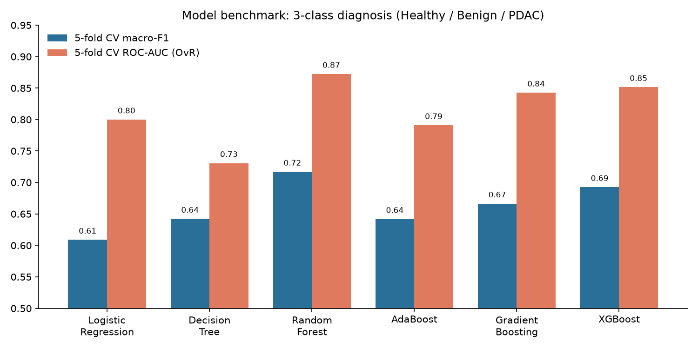
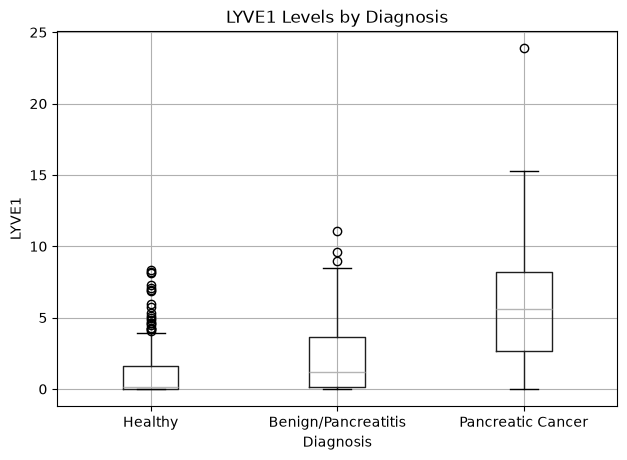
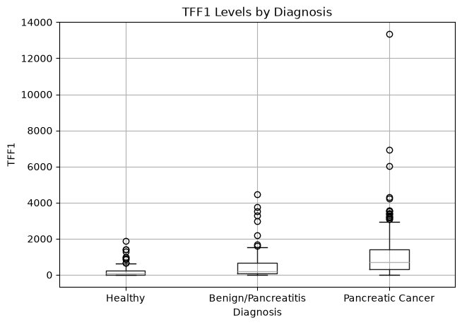
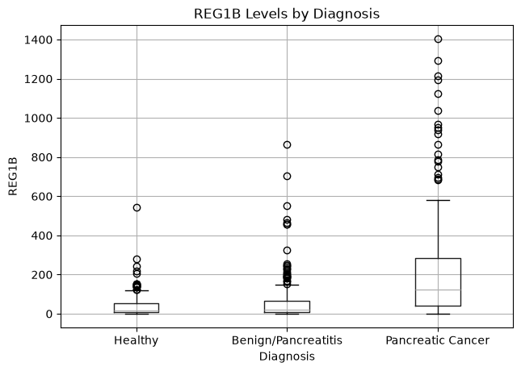
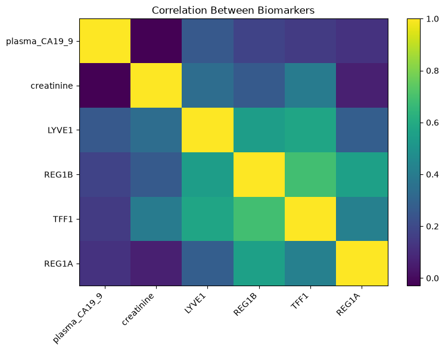
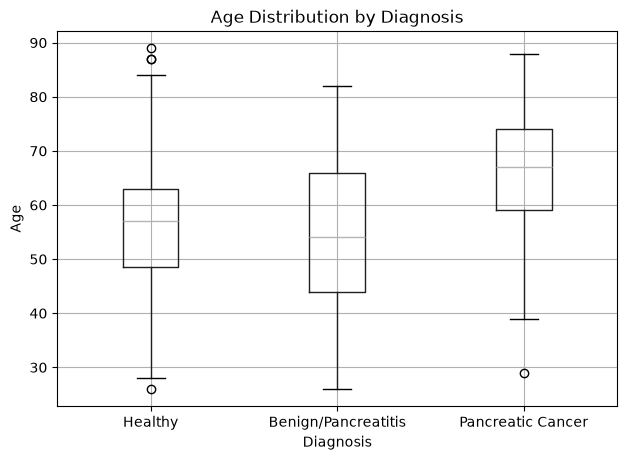

<div align="center">

# 🧬 UroSignal-PDAC
### Non-Invasive Pancreatic Cancer Detection from Urinary Biomarkers with Ensemble Machine Learning

*A liquid-biopsy classification pipeline that separates **healthy**, **benign pancreatic disease** and **pancreatic ductal adenocarcinoma (PDAC)** using a urine test and a few clinical variables.*


</div>

---

## 📌 TL;DR

| | |
|---|---|
| **Problem** | Pancreatic cancer is usually found late. Five-year survival is about 10%, mainly because there is no cheap, non-invasive screening test. |
| **Approach** | Multi-class supervised learning on **590 patients** from 4 clinical centres (UK & Spain), using urinary proteins **LYVE1, REG1A, REG1B, TFF1**, creatinine, plasma CA19-9, age and sex. |
| **Models** | Benchmarked 6 algorithms (Logistic Regression, Decision Tree, Random Forest, AdaBoost, Gradient Boosting and XGBoost), each inside a leakage-safe scikit-learn `Pipeline`. |
| **Best results** | **0.87 ROC-AUC** (Random Forest, 5-fold CV) · **93% recall on the cancer class** (Gradient Boosting / XGBoost, held-out test) · **80% CV accuracy** on the Cohort 1 subset (XGBoost) |
| **Extra analyses** | Ablation of the REG1A feature, a cohort-shift (batch effect) experiment, and analysis of missing values by diagnosis. |

---

## 🎯 Why This Matters

Pancreatic ductal adenocarcinoma is one of the deadliest cancers. Most patients are diagnosed at stage III–IV, when surgery is no longer an option. Imaging is expensive and invasive, and the standard blood marker **CA19-9** misses a large share of early tumours.

A **urine-based panel** costs little, is painless, and could be repeated often, so it is a good candidate for screening high-risk groups. This project asks:

> **Can machine learning on a small panel of urinary biomarkers separate pancreatic cancer from both healthy people and benign pancreatic disease (e.g. chronic pancreatitis)?**

The hardest clinical case is telling **benign** disease apart from **cancer**, because both can raise the same markers. That is why the task is framed as **3-class** classification rather than a simpler cancer-vs-healthy split.

---

## 🗂️ Dataset

**Source:** Debernardi S. *et al.* (2020). *A combination of urinary biomarker panel and PancRISK score for earlier detection of pancreatic cancer: A case–control study.* **PLOS Medicine** 17(12): e1003489. ([Kaggle mirror](https://www.kaggle.com/datasets/johnjdavisiv/urinary-biomarkers-for-pancreatic-cancer))

| Property | Value |
|---|---|
| Samples | 590 patients |
| Sites | Barts Pancreas Tissue Bank (London), Spanish National Cancer Research Centre (Madrid), Liverpool University, UCL |
| Classes | Healthy (183) · Benign hepatobiliary disease (208) · PDAC (199). The classes are roughly balanced. |
| Features | `age`, `sex`, `patient_cohort`, `creatinine`, `LYVE1`, `REG1B`, `TFF1`, `REG1A`, `plasma_CA19_9` |

| Biomarker | Biological role |
|---|---|
| **LYVE1** | Lymphatic vessel endothelial receptor, linked to tumour metastasis |
| **REG1A / REG1B** | Regenerating-islet proteins, linked to pancreas regeneration |
| **TFF1** | Trefoil Factor 1, involved in mucosal repair |
| **Creatinine** | Kidney-function marker, used to normalise urine concentration |
| **Plasma CA19-9** | The current clinical blood marker, used as a reference |

---

## 🔬 Methodology

```text
 Raw CSV ─► Data audit ─► Cleaning & encoding ─► ColumnTransformer ─► Model zoo ─► Stratified 5-fold CV ─► Hold-out test ─► Ablation & cohort analysis
             (missingness   (target remap,          ├─ numeric: median          (6 models)     (accuracy, macro-P/R/F1,
              by class)      leakage-prone           │  impute + StandardScaler                 OvR weighted ROC-AUC)
                             columns dropped)        └─ categorical: mode
                                                        impute + One-Hot
```

### 1. Data audit and cleaning
- Profiled missing data. `plasma_CA19_9` is missing for **41%** of patients and `REG1A` for **48%**. Missingness is **not random**: about 50% for healthy and benign patients but only about 25% for cancer patients. Missingness is therefore informative, a known risk in clinical datasets.
- Removed **`stage`** and **`benign_sample_diagnosis`**. These columns are filled in only *after* a diagnosis, so keeping them would leak the target directly into the model.
- Re-encoded the target as `0 = Healthy`, `1 = Benign`, `2 = PDAC` and encoded the categorical variables.

### 2. Leakage-safe preprocessing
- Built a `ColumnTransformer` with **median imputation + standardisation** for the numeric features and **mode imputation + one-hot encoding** for the categorical ones.
- Wrapped the transformer and the estimator in a single `sklearn.Pipeline`, so imputation and scaling are fitted **only on the training folds**. This prevents data from the validation folds leaking into training.
- Used a stratified 80/20 train/test split (`random_state=42`) to keep the class proportions the same in both sets.

### 3. Model benchmarking
| Family | Models |
|---|---|
| Linear baseline | Multinomial Logistic Regression |
| Tree | Decision Tree (CART) |
| Bagging ensemble | Random Forest (300 trees) |
| Boosting ensembles | AdaBoost · Gradient Boosting · **XGBoost** (`multi:softprob`, row/column subsampling) |

Each model was scored with **Stratified 5-fold cross-validation** on accuracy, macro precision, macro recall, macro F1 and **one-vs-rest weighted ROC-AUC**, then checked again on the untouched test set.

### 4. Experiments
- **Feature ablation (REG1A):** REG1A is missing for an entire cohort. I retrained the tree models without it to measure how much each model depends on it.
- **Cohort-shift analysis:** I retrained on **Cohort 1 only** to test whether merging the two collection cohorts adds batch-effect noise.
- **Exploratory analysis:** biomarker distributions by diagnosis, age effects and the correlation structure between biomarkers.

---

## 📊 Results

### Model benchmark (full dataset, 3-class)

<p align="center"></p>

| Model | CV Accuracy | CV Macro-F1 | CV ROC-AUC (OvR) | Test Accuracy |
|---|---|---|---|---|
| Logistic Regression | 0.608 ± 0.030 | 0.609 | 0.800 | 0.754 |
| Decision Tree | 0.642 ± 0.055 | 0.642 | 0.731 | 0.686 |
| **Random Forest** | **0.716 ± 0.034** | **0.717** | **0.872** | 0.754 |
| AdaBoost | 0.640 ± 0.022 | 0.642 | 0.791 | 0.746 |
| Gradient Boosting | 0.665 ± 0.033 | 0.666 | 0.843 | **0.771** |
| XGBoost | 0.693 ± 0.037 | 0.693 | 0.851 | **0.771** |

**Per-class performance, Gradient Boosting (held-out test set):**

| Class | Precision | Recall | F1 |
|---|---|---|---|
| Healthy | 0.75 | 0.73 | 0.74 |
| Benign | 0.69 | 0.66 | 0.68 |
| **Pancreatic cancer** | **0.86** | **0.93** | **0.89** |

> 🩺 **Clinical reading:** the models catch **37 of 40 cancer cases** in the test set. Most of the remaining errors are between *healthy* and *benign*, which is the clinically less dangerous mistake.

### Experiments

| Model | Full data (test acc.) | Without REG1A (test acc.) | Cohort 1 only (test acc.) | Cohort 1 only (5-fold CV acc.) |
|---|---|---|---|---|
| Decision Tree | 0.686 | 0.703 | 0.806 | 0.729 ± 0.041 |
| Gradient Boosting | 0.771 | **0.780** | 0.821 | 0.789 ± 0.051 |
| XGBoost | 0.771 | 0.754 | 0.821 | **0.801 ± 0.045** |

**What the experiments show:**
1. **REG1A is mostly redundant.** Dropping it changes test macro-F1 by less than 2 points (−0.019 to +0.014). REG1A correlates with REG1B (r = 0.56), so a simpler panel loses little.
2. **Cohort heterogeneity matters.** Training on a single cohort raises CV accuracy from about 0.69 to about 0.80. This suggests a batch or site effect between the collection rounds, a common problem with real-world clinical data. Cohort 1 also has a different class mix (49% PDAC), so part of the gain comes from that difference.
3. **Ensembles beat single models.** Bagging and boosting consistently outperform the single tree and the linear baseline, which suggests the relationships between biomarkers are non-linear.

### Exploratory data analysis

<p align="center">
  
  
  
</p>
<p align="center">
  
  
</p>

| Median value | Healthy | Benign | PDAC | Fold change (PDAC vs Healthy) |
|---|---|---|---|---|
| LYVE1 (ng/ml) | 0.15 | 1.21 | 5.62 | **~39×** |
| TFF1 (ng/ml) | 59.8 | 210.2 | 722.5 | **~12×** |
| REG1B (ng/ml) | 17.6 | 20.2 | 123.1 | **~7×** |
| REG1A (ng/ml) | 113.0 | 127.2 | 411.0 | ~3.6× |
| Creatinine (mg/ml) | 0.71 | 0.75 | 0.72 | ~1× (a control, as expected) |

- **LYVE1, TFF1 and REG1B** increase step by step from healthy to benign to cancer, which makes them strong discriminators.
- **Creatinine** is flat across the classes. This confirms it reflects urine dilution rather than disease.
- Cancer patients are older on average (median age **67** vs **57** for healthy patients), so age is a meaningful covariate.

---

## 🛠️ Tech Stack

| Area | Tools |
|---|---|
| Language | Python 3.13 |
| Data wrangling | pandas, NumPy |
| Machine learning | scikit-learn (`Pipeline`, `ColumnTransformer`, `StratifiedKFold`, `cross_validate`), XGBoost |
| Statistics | SciPy |
| Visualisation | Matplotlib, Seaborn |
| Environment | Jupyter Notebook, venv |

---

## 🚀 Quick Start

```bash
git clone https://github.com/Nayab-U/Nayab-Gutierrez-joint-ML-project.git
cd Nayab-Gutierrez-joint-ML-project

python -m venv .venv && source .venv/bin/activate
pip install -r requirements.txt

jupyter notebook Uri_biomarkers_P-cancer.ipynb
```

## 📁 Repository Structure

```text
├── Uri_biomarkers_P-cancer.ipynb          # Full pipeline: EDA → preprocessing → modelling → experiments
├── Debernardi et al 2020 data.csv         # Dataset (590 patients)
├── Debernardi et al 2020 documentation.csv# Data dictionary
├── ML-urinary. biomarkers presentation.md # Link to the project slide deck (PDF)
├── images/                                # Figures used in this README
├── requirements.txt
└── README.md
```

---

## ⚠️ Limitations

- **Small sample size.** 590 patients and a 118-patient test set mean test metrics vary by a few points from one split to another. CV scores are the more reliable estimate.
- **Informative missingness.** CA19-9 and REG1A are missed more often in non-cancer patients. Median imputation can let a model learn *"was this test ordered?"* instead of the biology.
- **Site and cohort confounding.** The cohort experiment shows a clear batch effect. External validation on an independent site is needed before any clinical claim.
- This is a **research and educational project** and is **not a diagnostic tool**.

## 🔭 Roadmap

- [ ] Hyperparameter optimisation with `GridSearchCV` / Optuna inside nested cross-validation
- [ ] Model explainability with **SHAP** values and permutation importance
- [ ] Probability calibration (`CalibratedClassifierCV`) and decision-curve analysis
- [ ] Missing-indicator features and `IterativeImputer` (MICE)
- [ ] Binary *PDAC vs non-PDAC* screening model with sensitivity tuned at fixed specificity
- [ ] Leave-one-site-out validation to measure how well the model generalises across hospitals
- [ ] Deploy as a **Streamlit** risk-calculator demo

---

## 👥 Authors

**Nayab** · Machine Learning / Data Science
[LinkedIn](https://www.linkedin.com/in/YOUR-HANDLE) · [GitHub](https://github.com/Nayab-U)

**Gutierrez** · Co-author
[LinkedIn](#) · [GitHub](#)

## 📚 References

1. Debernardi S, O'Brien H, Algahmdi AS, *et al.* (2020). A combination of urinary biomarker panel and PancRISK score for earlier detection of pancreatic cancer: A case–control study. *PLOS Medicine* 17(12): e1003489. https://doi.org/10.1371/journal.pmed.1003489

---

<div align="center">
<sub>If this project was useful or interesting, consider giving it a ⭐</sub>
</div>
